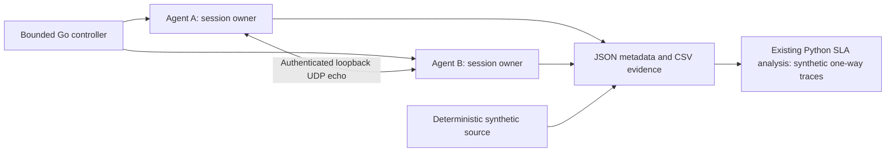

# Building a Distributed Network Measurement Engine in Go

The engineering problem was to make a legacy FPGA/SFP measurement controller
reviewable and reproducible without pretending that hardware-free tests validate
datapath timestamps. The existing application combines MySQL scheduling, SNMP,
raw Ethernet generation, Linux packet rings and statistics. Its protocol and schema
are compatibility constraints; the Python trace analysis already has useful tests
and reports and should remain the analysis implementation.

The first change corrected reproducible SQL status/placeholder errors and socket
resource defects. Constructor failure now closes its descriptor, close releases
mmap memory, and packet lengths are checked before slicing. Polling materializes
rows before dispatch, and SNMP monitors have cancellation and join ownership.
A fixed dispatcher limits legacy hardware jobs to one active measurement to avoid
competing generators. [The audit](go-engineering-audit.md) records both the fixes
and the substantial legacy hardware paths that remain unqualified.

Go fits the session/control work because contexts, timers, network deadlines,
standard-library HTTP/UDP, race testing and cross-compilation support a compact
implementation. The new engine avoids calling the unresolved legacy worker paths.
It does not need a new production dependency or an architecture replacement for
the historical control application.

Each synthetic session has a random identity and a versioned/hashable model
configuration. Per-packet integer generation is independent of worker scheduling.
Workers write distinct indexed slots and are joined before export; canceled runs
publish only the completed prefix. Packet loss and jitter semantics follow the
existing trace contract. A result package is published only after files close.

The local bench adds explicit start/query/cancel control, agent identification,
strict loopback address validation and authentication. Two agents make independent
software RTT observations against each other's echo endpoints. Each probe uses a
random nonce, sequence and authenticated fixed-size message. Memory is bounded by
configuration, active-session slots and capped result retention. Network deadlines
and a separately bounded cleanup path handle missing replies and lost control
connections. These are coordinated sessions, not synchronized launches.

Timestamp provenance is part of the result format. The model emits synthetic
relative nanoseconds; the UDP source measures local monotonic application RTT.
Software wall timestamps are diagnostic, and no software RTT is put in a one-way
SLA column. RTT results use their own CSV. A future timestamp-input boundary can
accept confirmed hardware captures, but no register map, clock calibration or FPGA
provider is invented here. Hardware claims still require the existing project's
measurement-quality gates.

[Validation evidence](go-validation.md) separates deterministic model outputs,
allocation benchmarks and actual loopback observations. Regression tests cover
SQL/buffer bounds, lifecycle, provenance, model repeatability, export, agent
cancellation, session bounds and connection loss. Linux race testing exercises
those paths without root or hardware. Small unit coverage of the old command must
not be read as a guarantee that its unexecuted hardware paths are race-free.

The result is a reproducible software engineering baseline with explicit limits:
Linux AMD64 runtime validation under WSL2; ARM builds with runtime pending; no
physical two-machine, FPGA, calibrated one-way or capacity qualification. The next
steps are a MySQL/hardware integration fixture for the remaining legacy workers,
a confirmed FPGA timestamp contract, and an authorized remote transport/deployment
experiment with measured clock state and failure behavior.
